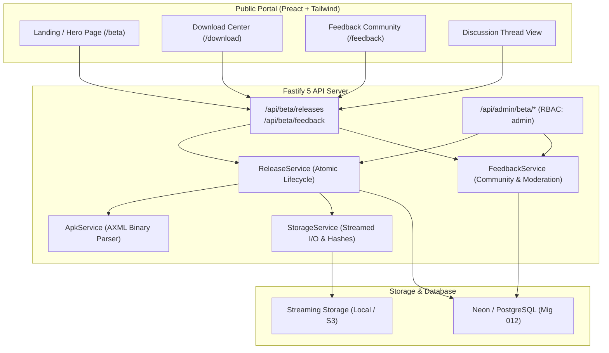

# Chandil Home Services — Beta Testing & APK Distribution Portal

## Overview & Architecture

The **Chandil Home Services Beta Testing & APK Distribution Portal** is a production-ready, human-designed release management and beta tester engagement platform for `in.chandilservices.app`.

It enables Chandil residents, service providers, and beta testers to:
1. Download the latest verified Android application builds directly.
2. Review exact binary versioning ($v1, v2, v3\dots$), release notes, APK file sizes, and SHA-256 integrity checksums.
3. Inspect step-by-step installation instructions optimized for budget Android smartphones (Android 5.1/6.0+).
4. Participate in an open community feedback board by reporting bugs, suggesting usability improvements, attaching screenshots, and conversing in threaded discussions.
5. Provide administrators with a secure, authenticated release management and moderation console.

---

## 1. System Architecture & Boundaries



---

## 2. Security & Environmental Isolation

- **Role-Based Access Control (RBAC):** All administrative endpoints under `/api/admin/beta/*` strictly enforce `requireRole(['admin'])` backed by FIDO2/WebAuthn passkey credentials and JWT session authentication.
- **Zero Memory Buffering of APKs:** File uploads and downloads are handled as streams via `@fastify/multipart` and Node.js `fs.createReadStream`. This guarantees low memory consumption on constrained hosting tiers (e.g. Render's 512MB RAM free tier).
- **HTTP 206 Resumable Streaming:** Download endpoints support the `Range: bytes=start-end` header, enabling resumable downloads over unstable 2G/3G mobile networks in Chandil, Chowka, and Kandra.
- **Mobile Bundle Isolation:** Mobile assets build scripts (`scripts/clean-android-assets.js`) and Gradle build rules (`aaptOptions.ignoreAssetsPattern = 'beta.html:beta*'`) ensure that beta testing web pages and administrative bundles are never bundled into the native Android application package.

---

## 3. Database Schema (Migration 012)

The beta testing portal introduces five relational tables:

1. **`app_releases`**:
   - `id`: UUID Primary Key
   - `release_number`: Integer sequential index ($1, 2, 3\dots$)
   - `version_display`: Human-readable identifier (`v1`, `v2`, etc.)
   - `version_name`: Extracted `android:versionName` (e.g., `1.0`)
   - `android_version_code`: Extracted `android:versionCode` (e.g., `1`)
   - `package_id`: Strictly validated package identifier (`in.chandilservices.app`)
   - `min_sdk` & `target_sdk`: Extracted SDK constraints (e.g. 22 and 34)
   - `file_size`: Byte size of the APK
   - `sha256`: Cryptographic SHA-256 checksum calculated in single pass
   - `changelog`: Release notes / description
   - `release_status`: `draft` | `published` | `withdrawn`
   - `is_latest`: Boolean flag enforcing single active latest release
   - `download_count`: Telemetry counter

2. **`release_downloads`**:
   - Download event audit records tracking timestamps, IP addresses (hashed/masked), and User-Agent strings.

3. **`beta_feedback`**:
   - Stores bug reports and user suggestions categorized by `BUG_REPORT`, `UI_DESIGN`, `PERFORMANCE`, `AUTH`, `BOOKING`, `WORKER_EXPERIENCE`, `FEATURE_REQUEST`, `OTHER`.
   - Resolution status: `NEW`, `UNDER_REVIEW`, `PLANNED`, `IN_PROGRESS`, `FIXED`, `WONT_FIX`.
   - Moderation flags: `is_pinned`, `is_reported`, `report_count`.

4. **`beta_feedback_comments`**:
   - Threaded replies to feedback items.
   - Distinguishes community comments from official administrative responses (`is_admin: true`).
   - Moderation status: `APPROVED` | `FLAGGED`.

5. **`admin_audit_logs`**:
   - Append-only audit log tracking administrator actions (`RELEASE_UPLOAD_DRAFT`, `RELEASE_PUBLISHED`, `RELEASE_WITHDRAWN`, `FEEDBACK_STATUS_CHANGE`, `COMMENT_MODERATED`).

---

## 4. Release Management Lifecycle

### Step 1: Uploading a New APK
- **Admin Navigation:** Go to `/admin` $\rightarrow$ Click **Releases** tab $\rightarrow$ Click **Upload New APK**.
- Select the built `.apk` binary (e.g., `app-debug.apk` or `app-release.apk`) and write release notes.
- **Server Verification:**
  - Fastify extracts and reads binary `AndroidManifest.xml`.
  - Verifies `package` equals `in.chandilservices.app`.
  - Extracts `versionCode`, `versionName`, `minSdkVersion`, and `targetSdkVersion`.
  - Allocates next sequential version number ($v1, v2\dots$) under an exclusive lock.
  - Automatically saves the release in `draft` status.

### Step 2: Verification in Draft State
- Draft releases are strictly quarantined:
  - Hidden from the public releases list (`/api/beta/releases`).
  - Attempting to download a draft APK via public URL returns `403 Forbidden` (`DRAFT_RELEASE`).

### Step 3: Publishing the Release
- Admin clicks **Publish Release**.
- The release transitions to `published`:
  - `is_latest` is atomically set to `true`.
  - Any prior `is_latest` release is atomically demoted.
  - An audit record is logged with the admin's identity.
  - Public portal hero section and download cards immediately update to reflect the new release.

### Step 4: Emergency Withdrawal
- If an issue is reported on specific devices, an administrator can withdraw the release by providing an explanation.
- The release transitions to `withdrawn`:
  - `is_latest` is revoked.
  - The system automatically elects the highest remaining published release as latest.
  - Public downloads of the withdrawn release show a prominent warning banner explaining the withdrawal reason.

---

## 5. API Reference

### Public Endpoints
| Method | Endpoint | Description |
|---|---|---|
| `GET` | `/beta` | Beta Testing Portal landing page |
| `GET` | `/download` | APK Download Center (SPA fallback) |
| `GET` | `/feedback` | Tester Feedback Community (SPA fallback) |
| `GET` | `/api/beta/releases/latest` | Returns active latest published release |
| `GET` | `/api/beta/releases` | Lists historical published releases |
| `GET` | `/api/beta/releases/:id/download` | Streams APK file with Range 206 & SHA-256 headers |
| `GET` | `/api/beta/feedback` | Lists feedback items with filtering & search |
| `POST` | `/api/beta/feedback` | Submits new feedback with optional screenshot |
| `GET` | `/api/beta/feedback/:id` | Returns single thread with approved comments |
| `POST` | `/api/beta/feedback/:id/comments` | Posts a reply to a discussion thread |
| `POST` | `/api/beta/feedback/:id/report` | Flags a post for moderation |

### Protected Admin Endpoints (`requireRole(['admin'])`)
| Method | Endpoint | Description |
|---|---|---|
| `GET` | `/api/admin/beta/releases` | Lists all releases including drafts |
| `POST` | `/api/admin/beta/releases/upload` | Multipart or base64 APK ingestion |
| `POST` | `/api/admin/beta/releases/:id/publish` | Publishes draft release |
| `POST` | `/api/admin/beta/releases/:id/withdraw` | Withdraws release with reason |
| `GET` | `/api/admin/beta/feedback` | Moderation feedback queue |
| `GET` | `/api/admin/beta/feedback/:id` | Full thread including flagged comments |
| `PATCH` | `/api/admin/beta/feedback/:id/status` | Updates resolution status |
| `PATCH` | `/api/admin/beta/feedback/:id/pin` | Toggles pinned discussion |
| `PATCH` | `/api/admin/beta/feedback/comments/:id/moderate` | Approves or flags comments |
| `POST` | `/api/admin/beta/feedback/:id/comments` | Posts official administrative response |
| `GET` | `/api/admin/beta/analytics` | Aggregated release and feedback metrics |
| `GET` | `/api/admin/beta/audit-logs` | Immutable audit log trail |

---

## 6. Verification & Test Suite

The test suite validates all requirements end-to-end:
```bash
# Run beta portal tests (101 assertions)
npm --workspace=server run test:beta

# Run static serving & SPA fallback tests (56 assertions)
npm --workspace=server run test:static

# Run administrative foundation tests (83 assertions)
npm --workspace=server run test:admin

# Build client production bundles (index.html, admin.html, beta.html)
npm --workspace=client run build

# Build server production bundle
npm --workspace=server run build
```
